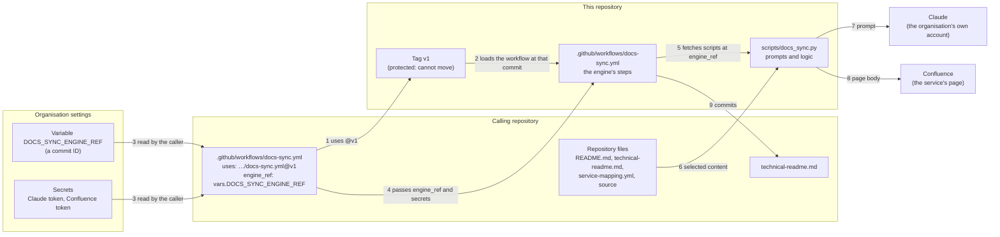

# Autodocs Engine — Quick Guide for AI Agents
This repository is the shared **documentation automation engine** used by other repositories.
Its job is to:
- read code/context from a target repo,
- ask an LLM to produce documentation updates,
- write technical markdown files,
- and update Confluence pages.

Use this guide to quickly find where to make changes without re-reading the whole codebase.

## How a run works, and what it sends

Two different files are both called `docs-sync.yml`:

- **The caller's workflow** lives in each repository that uses autodocs. It is short: it names the engine and passes settings in.
- **The engine's workflow** lives here. It holds the steps, and it is the part that receives the secrets.

### What leaves the calling repository

- **To Claude, under the organisation's own Claude token:**
  - the prompts;
  - the repository's file list;
  - `README.md`, `technical-readme.md` and `service-mapping.yml`;
  - the current Confluence page and any related pages it names;
  - the names of the files a pull request changed;
  - the full text of up to `max_request_files` files the model asks to read (20 in the usual settings).
- **To Confluence:** the page body for the service's page, and, where the service opts in, its entry on the parent page.
- **Back to the repository:** a commit of `technical-readme.md`.

The pull request diff itself is downloaded to the runner but never sent: only the names of the files it touched are.

Files with credential-like names (`.env*`, `.npmrc`, key files, `*.tfvars`, `*.tfstate`, `localEnv*` and paths under `secrets/`, `credentials/`, `keys/`, `vault/` or `private/`) are never offered to the model. Their contents are not checked, though. A secret written directly into an ordinary source file would be sent if the model asked for that file, so keep secrets out of source.

### What is fixed, and what is not

- **Fixed: the engine's workflow.** A caller names it as `@v1`. The repository rule `tagging` stops any `v*` tag being moved, deleted or newly created, and requires tags to be signed, so `v1` always means the same commit. Anyone can check the rule on this repository's rules page (`github.com/panda-don0/autodocs/rules`) or through the API; only its owner can bypass or change it.
- **Fixed: the scripts and prompts.** The engine's workflow fetches them at `engine_ref`, which callers take from the organisation variable `DOCS_SYNC_ENGINE_REF`, a commit ID. Changing that one variable moves every repository to a new engine version at once.
- **Not fixed: the tools installed during a run.** The usual caller settings run Claude Code as `npx -y @anthropic-ai/claude-code`, which installs its newest release each time. The workflow installs the newest `requests` and `pyyaml` from PyPI. Both run while the run holds the Claude and Confluence tokens. Pin their versions to fix them.

## Mental model (high-level)
Think of this repo as 3 layers:
1. **Workflow orchestration** (how/when it runs): `.github/workflows/docs-sync.yml`
2. **Engine behavior** (what it does): `scripts/docs_sync.py`
3. **Required-check gatekeeping** (when PR mode is allowed to proceed): `scripts/wait_required_checks.py`

`config.yml` defines defaults and paths used by consumers of this engine.

## Execution flow
In normal PR mode:
1. Workflow starts from reusable workflow input.
2. Required checks are polled (optional behavior, controlled by caller config).
3. PR diff and repo context are collected.
4. LLM pass 1 can request additional files.
5. LLM pass 2 returns technical-readme + Confluence summary.
6. Engine updates docs targets and exits.

In manual mode, it skips PR-specific gating and uses current repo state.

## Fast targeting guide (request -> where to search)
If the request is about **workflow triggers, inputs, permissions, job sequence, or commit/push behavior**:
- Start at `.github/workflows/docs-sync.yml`

If the request is about **what context is sent to the model**:
- Start at `scripts/docs_sync.py`
- Search for prompt construction and context assembly in `main()` and the pass-1/pass-2 prompt blocks.
- For shared services across multiple repos, search for `service_repo_topology` parsing and prompt injection logic.

If the request is about **file filtering, exclusions, or sensitive-file protection**:
- Start at `scripts/docs_sync.py`
- Search for:
  - `SENSITIVE_FILE_NAMES`, `SENSITIVE_PATH_TOKENS`, `SENSITIVE_SUFFIXES`
  - `is_sensitive_path`
  - `should_exclude_from_doc_context`
  - `read_requested_files_context`

If the request is about **how LLM output is parsed/validated**:
- Start at `scripts/docs_sync.py`
- Search for:
  - `MODEL_OUTPUT_DELIMITER`, `NO_UPDATE_MARKER`, `REQUEST_FILES_MARKER`
  - `parse_generation_output`
  - `validate_technical_markdown_output`
  - `validate_confluence_storage_output`

If the request is about **Confluence read/write issues**:
- Start at `scripts/docs_sync.py`
- Search for:
  - `confluence_headers`
  - `fetch_confluence_page`
  - `update_confluence_page`

If the request is about **LLM provider/runtime behavior** (Claude Code vs API, command invocation, env requirements):
- Start at `scripts/docs_sync.py`
- Search for:
  - `call_claude`
  - `call_claude_via_claude_code`
  - `call_claude_via_anthropic`

If the request is about **required checks waiting logic**:
- Start at `scripts/wait_required_checks.py`
- Search for `main()` and `github_get`.

If the request is about **engine defaults and standard paths**:
- Start at `config.yml`

If the request is about **prompt assets/shared prompt conventions**:
- Start at `prompts/README.txt`

## What this repo does NOT own
Some important files are expected in the **consumer repository** (not this engine repo), e.g.:
- `service-mapping.yml`
- `docs-sync-config.yml`
- service code being documented

If behavior seems “missing” here, check the caller repo inputs and mapping files first.

## Caller repo templates (start here before writing from scratch)
A generic caller-repo example is included at:
- `examples/caller-repo/.github/workflows/docs-sync.yml`
- `examples/caller-repo/docs-sync-config.yml`
- `examples/caller-repo/service-mapping.yml`

Use these as starter templates when onboarding docs sync in a new repository.
They are intentionally generic, so replace placeholders like:
- `YOUR_ORG/autodocs`
- `DOCS_ENGINE_REF`
- `DOCS_*` secret names
- `example-service`, `example-repo`, and placeholder page IDs
This v2 release is backward compatible with v1 configuration layouts.

When a service is managed by multiple repos (for example backend + frontend sharing one Confluence page),
define `service_repo_topology` in `service-mapping.yml` so the model gets explicit multi-repo context.
Mapping layout support is backward compatible; existing configurations continue to work.

If an agentic request is “set up docs sync in this repo,” these three files should be the first target search/edit locations.

## Parent page entries
A service whose mapping sets `parent_summary: true` also keeps a two-or-three-sentence entry on its
parent Confluence page (the direct parent, or `parent_page_id`). The logic is in `scripts/parent_page.py`:
- Entries live in a "Services in this area" section bounded by anchor macros; nothing outside it, and no
  other service's entry, is changed.
- A parent with no section gets one at the end; a new service is inserted in name order.
- A save that clashes with another run (HTTP 409) re-reads the parent and retries once, then fails.
- The parent page must stay hand-written: never map it as any service's own page.

Tests: `python -m pytest tests`.

## Suggested debug order for most incidents
1. Confirm mode/inputs in `.github/workflows/docs-sync.yml`
2. Check filtering + context collection in `scripts/docs_sync.py`
3. Check output parsing/validation in `scripts/docs_sync.py`
4. Check Confluence API sections in `scripts/docs_sync.py`
5. Check required check gating in `scripts/wait_required_checks.py`

## Practical rule of thumb
For almost any feature or bug request, begin in `scripts/docs_sync.py`.
Use the workflow file only when the issue sounds like orchestration, permissions, trigger, or commit/push behavior.